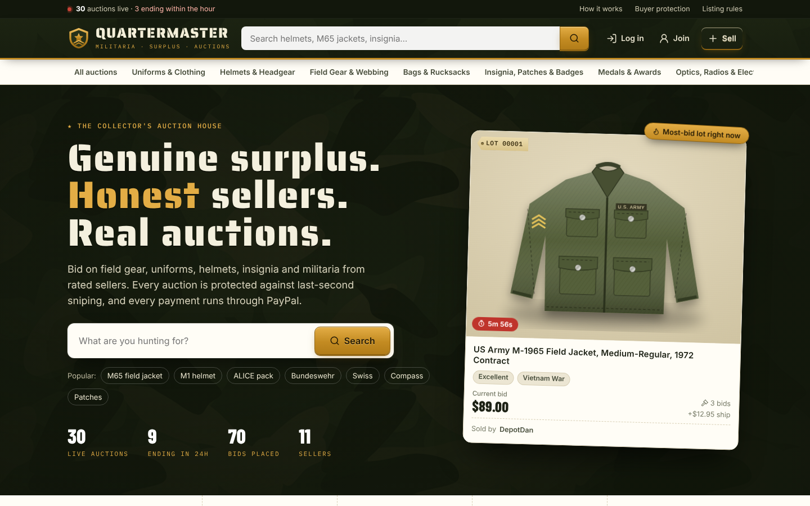

# Quartermaster

An eBay-style auction marketplace for army surplus and militaria. Members list their own
items, bid against each other, pay the seller through PayPal, and rate each other afterwards.



## What's in this first version

**Buying**
- Home page with live stats, "ending soon", "hot right now" and "just listed" rails, and category tiles
- Search with filters (category, condition, price range, ending within 1h/24h, no-reserve) and sorting
- **Sold items price guide**: browse completed sales to see what things actually go for
- Listing pages with a photo gallery, item specifics (era, country, markings, provenance), bid history with
  anonymised bidder names, seller trust card, and a live countdown
- **Proxy bidding**: bidders enter a maximum and the site bids for them in standard increments
- **Reserve prices**: bidders only see whether the reserve is met, never the amount
- **Anti-sniping**: a bid in the last 2 minutes extends the auction to 2 minutes after that bid
- Two-step bid confirmation that spells out the commitment and shipping cost
- Watchlist, "you've been outbid" and "you won" notices

**Selling**
- Five-step listing form with drag-and-drop photos (up to 10, resized in the browser), a live preview card,
  starting bid, optional reserve, 1 to 10 day auctions, shipping, returns and an authenticity pledge
- Seller dashboard: live listings with bids and watchers, sold items with the buyer's ship-to address,
  and a "mark shipped" form with carrier and tracking number
- Sellers can cancel a listing until the first bid

**Trust & safety**
- Order timeline for both sides: Won → Paid → Shipped → Delivered
- Feedback only from buyers who won and paid, one rating per item; seller profiles show average rating,
  positive %, items sold and bought, rating breakdown, and a Top-rated badge (3+ ratings, 95%+ positive)
- Listing rules page (no firearms, ammunition, explosives, reproductions sold as originals, etc.) that sellers
  must confirm for every listing
- Report a listing → staff moderation page to remove listings or dismiss reports
- Usernames that impersonate staff are blocked; login is throttled after 5 failed attempts
- Uploaded photos are checked by file content (not just extension) and served with a locked-down
  Content-Security-Policy
- Buyer-seller messaging with safety tips, plus automated notices from a "Quartermaster" system account

**Payments (PayPal)**
- Winners pay with PayPal Smart Buttons on their "Won" tab. The order is created and captured on the server,
  with the **seller's PayPal email as the payee**, so money goes straight to the seller
- The captured amount and listing are verified before an order is marked paid, and the buyer's PayPal
  shipping address is passed to the seller
- Without PayPal keys, development builds show a clearly labelled "Simulate PayPal payment (demo)" button
  so the whole flow can be tried end to end

**Seller fees and featured lots (how the site makes money)**
- When a buyer pays for an item, the seller owes the site a percentage of the winning bid (5% by default,
  shipping not included). Nothing is owed if the buyer never pays
- Sellers can **feature** a lot ($2.99 by default) when they list it or later from their dashboard. Featured
  lots get a brass badge, a place in the home page's Featured row and the hero spotlight, and the top four
  spots in matching searches until the auction ends
- Both build up under **My Quartermaster › Fees**, and sellers pay them with PayPal into the site's own
  PayPal account (the one the PayPal keys belong to)
- Each fee is due within 30 days. A seller with an older unpaid fee can't list or feature new items until
  they pay; their live auctions carry on
- Staff set the sale fee rate, the date sale fees start from and the feature price on the **Moderation**
  page, see who owes what, and can waive a fee. A new site starts sale fees 60 days after it first runs, so
  early sellers sell free; featuring is charged from day one

## Run it locally

You need Node.js 20 or newer.

```bash
npm install
npm run seed     # creates data/ with demo members, 45 illustrated lots, bids, sales and feedback
npm run dev      # http://localhost:3000
```

Demo accounts (password `surplus123` for all):

| Email | Who |
| --- | --- |
| `demo@quartermaster.test` | A buyer *and* seller with active bids, a win to pay for, a parcel to confirm and an item to ship |
| `staff@quartermaster.test` | Moderator: sees the **Moderation** link in the top bar |
| `dan@example.com`, `bernd@example.com`, … | Sellers from the demo data |

The demo auctions are timed relative to when you run the seed (some end within minutes), so run
`npm run seed` again any time you want fresh timers. **The seed wipes the `data/` folder.**

For a production build: `npm run build && npm start`. Add `DEMO_PAYMENTS=1` to keep the simulated
payment button in a production build for demos.

## Connect PayPal

1. Sign in at [developer.paypal.com](https://developer.paypal.com) and create an app under **Apps & Credentials**.
2. Copy `.env.example` to `.env.local` and fill in `PAYPAL_CLIENT_ID` and `PAYPAL_CLIENT_SECRET`. Keep
   `PAYPAL_ENV=sandbox` while testing with PayPal's sandbox buyer and seller accounts.
3. Each seller enters their PayPal email when they list (or in **My bids › Settings**). That's where
   buyers' payments land.
4. Switch to `PAYPAL_ENV=live` with live credentials when you launch.

Seller fees are paid in a separate PayPal payment into your own account. Taking the fee out of the buyer's
payment automatically would need PayPal's marketplace program (Commerce Platform partner approval); once
approved, a platform fee can be added to the buyer's order in `src/lib/paypal.ts`.

## Deploying

The app stores its database (SQLite) and photos on disk in `data/` (or `DATA_DIR`), so host it somewhere
with a **persistent disk**: for example a small VPS, Render or Railway with a volume, or Fly.io with a volume.
Serverless hosts like Vercel would need the database moved to Postgres and photos to object storage first.

**Render:** `render.yaml` is a ready-made Blueprint. Click the button (or in Render choose **New › Blueprint**
and pick this repo). Render asks for `ADMIN_EMAILS` and creates a web service with a 1 GB disk mounted at
`/var/data` for the database and photos.

[](https://render.com/deploy?repo=https://github.com/operations215/auction)

When you have PayPal keys, add `PAYPAL_CLIENT_ID` and `PAYPAL_CLIENT_SECRET` in the service's **Environment**
tab, and change `PAYPAL_ENV` to `live` when you're ready for real money. Render redeploys automatically.

A live site starts empty (no demo data). Put your own email in `ADMIN_EMAILS`, then sign up with it to get
the **Moderation** page.

## How it's built

- [Next.js 15](https://nextjs.org) App Router with server components and server actions, TypeScript
- SQLite via `better-sqlite3` (schema in `src/lib/db.ts`, created automatically on first run)
- Cookie sessions with bcrypt-hashed passwords (`src/lib/auth.ts`)
- Plain CSS design system in `src/app/globals.css` (light and dark mode), `lucide-react` icons,
  Google Fonts via `next/font` (Saira Stencil One, Barlow Condensed, Inter, IBM Plex Mono)

```
src/
  app/                 pages and server actions (actions.ts)
    api/paypal/        create and capture PayPal orders (buyers paying sellers)
    api/paypal/fees/   create and capture fee payments (sellers paying the site)
    api/images/        serves uploaded photos
  components/          bid box, gallery, countdown, forms, cards
  lib/
    auctions.ts        bidding engine, increments, anti-sniping, auction closing, queries
    paypal.ts          PayPal Orders v2 client
    fees.ts            seller fees and featured lots: charging, balances, payments, settings
    db.ts              schema and connection
scripts/
  seed.ts              demo data
  art.ts               generates the demo item illustrations
```

## Good next steps

- Email notifications (outbid, won, paid, shipped) via a provider like Postmark or Resend
- A scheduled job to close auctions exactly on time (today they close on the next page view)
- Move photos to object storage and the database to Postgres when traffic grows
- Seller verification (ID or PayPal-verified badge) and dispute handling
- Terms of service, privacy policy, and a legal review of militaria rules for the countries you serve
